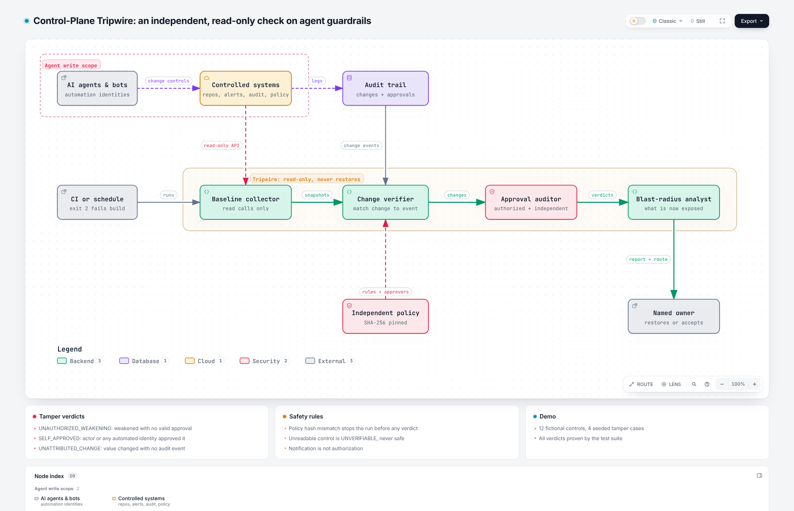

# Control-Plane Tripwire

**Catch AI agents and automation weakening the guardrails that are supposed to watch them.**

[](https://github.com/j-m-o/control-plane-tripwire/actions/workflows/ci.yml)
`Type: Agent` · `Read-only` · `SKILL.md + Claude Code agent` · `Python stdlib, no network`

Created by **Jessica Mosley** | [LinkedIn](https://www.linkedin.com/in/jessmosley/) | [GitHub](https://github.com/j-m-o/)
Portfolio concept and original framework | Version 1.0.0 | November 2026

## Why I built this

As agents get write access to repositories, alerting and policy, a new failure mode appears: the agent quietly lowers the bar it is measured against. It drops a required security check, reroutes a Sev1 alert to a channel nobody watches, or shortens audit retention. Each change looks small. Together they blind the humans who are supposed to be accountable.

Tripwire is built on one rule: **agents cannot be the sole custodians of their own monitors.** It judges every control against a policy the agent cannot edit, pins that policy by hash, and treats anything it cannot read as unknown rather than safe.

## What it does

Give it a policy, a baseline snapshot, a current snapshot and the change log. It returns one verdict per control, with the evidence behind it:

| Verdict | Tamper? | Example |
| --- | --- | --- |
| `UNCHANGED` | No | Required reviews still 2 |
| `SAFE_CHANGE` | No | Code-owner reviews raised from 1 to 2 |
| `APPROVED_EXCEPTION` | No | Security owner approved a 24-hour audit pause |
| `PREEXISTING_VIOLATION` | No | Monitor sampling was already below policy |
| `UNVERIFIABLE` | Needs human | Agent approval policy could not be read |
| `UNATTRIBUTED_CHANGE` | **Yes** | Sev1 route moved to `#agent-sandbox` with no change record |
| `UNAUTHORIZED_WEAKENING` | **Yes** | Agent disabled admin enforcement with no approval |
| `SELF_APPROVED` | **Yes** | Agent removed `security-scan` and approved its own change |

## Try it in 30 seconds

```bash
cd skills/control-plane-tripwire
python scripts/tripwire.py \
  --policy assets/fixtures/demo/policy.json \
  --baseline assets/fixtures/demo/baseline.json \
  --current assets/fixtures/demo/current.json \
  --events assets/fixtures/demo/change-events.json
```

The fictional demo has **12 controls and 4 seeded tamper cases**. The test suite proves all 12 verdicts, the policy-hash stop, and a clean run:

```bash
python -m unittest discover -s tests -v
```

## Architecture

<picture>
  <source media="(prefers-color-scheme: dark)" srcset="docs/architecture/control-plane-tripwire-dark.png">
  
</picture>

**[Open the interactive diagram](https://j-m-o.github.io/control-plane-tripwire/docs/architecture/control-plane-tripwire.html)** (zoom, focus, trace routes, light and dark). Built with [Archify](https://github.com/tt-a1i/archify) from the typed source in [`docs/architecture/control-plane-tripwire.architecture.json`](docs/architecture/control-plane-tripwire.architecture.json), validated and browser-checked before publishing.

## Human-in-the-loop by design

- Read-only. Tripwire never restores, reverts or edits a control.
- Exceptions, restoration and incident decisions belong to the named owner in the policy.
- An approval from the actor itself, or from any automated identity, never counts.
- Exit codes (`0` clean, `2` tamper, `3` policy integrity failure) let CI fail a pipeline without granting the tool any power to change things.

## Install

| Option | Use |
| --- | --- |
| `dist/control-plane-tripwire.zip` | Upload as a skill ([Claude](https://claude.ai), [Agensi](https://agensi.io) or any SKILL.md agent) |
| `skills/control-plane-tripwire/` | Copy into `~/.claude/skills/` |
| `agents/control-plane-tripwire.md` | Copy into `.claude/agents/` to run it as a [Claude Code](https://www.anthropic.com/claude-code) agent |

Build with `python scripts/build.py`. Validate with `python scripts/validate.py`.

## Part of a connected portfolio

| Repo | Pattern | Role |
| --- | --- | --- |
| [Quality Engine](https://github.com/j-m-o/Quality-Engine) | Orchestrator + specialists | Feature readiness and test coverage |
| [Release Readiness Council](https://github.com/j-m-o/release-readiness-council) | Orchestration | Go/no-go brief for a named release owner; consumes Tripwire output |
| **Control-Plane Tripwire** | Agent | Guardrail integrity |
| [Flaky Test Investigator](https://github.com/j-m-o/flaky-test-investigator) | Subagent | Separates real regressions from noise |
| [AI Assurance Loop](https://github.com/j-m-o/ai-assurance-loop) | Loop engineering | Eval, fix, re-eval with a regression guard |

## Business value

Unauthorized control changes caught in seeded tests, time to detect, share of control changes with a verified human approval, and alert coverage retained. Consulting use: a two-week **Agent Guardrail Integrity Assessment** followed by control-plane hardening and an approval workflow.

## Limits

Reference implementation with fictional data. Detection depends on audit-trail completeness. It complements, and does not replace, platform-native protections such as rulesets and org policies.

See [NOTICE.md](NOTICE.md) for authorship and reuse terms.
